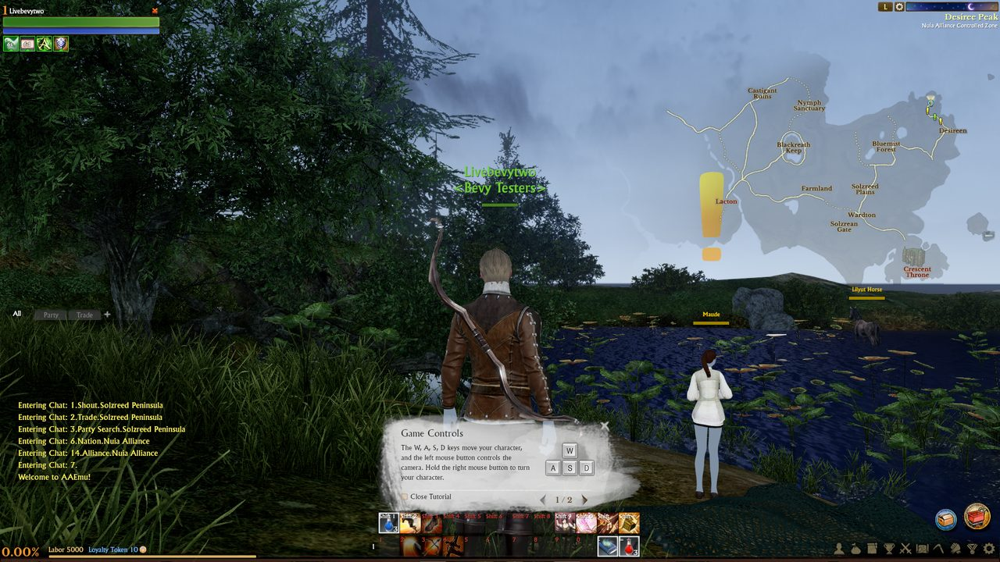
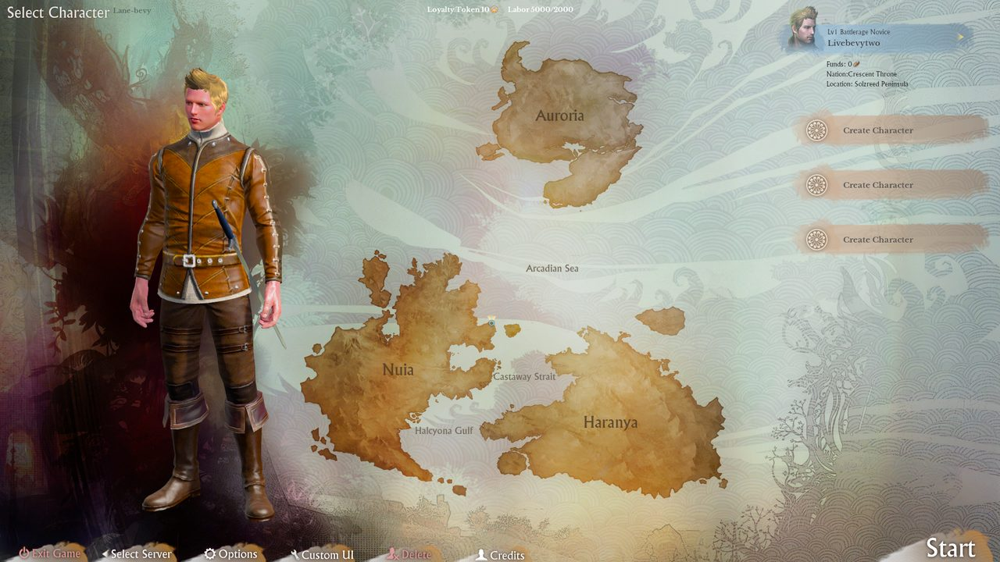
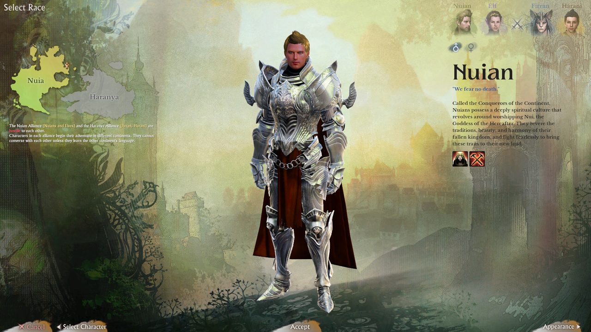
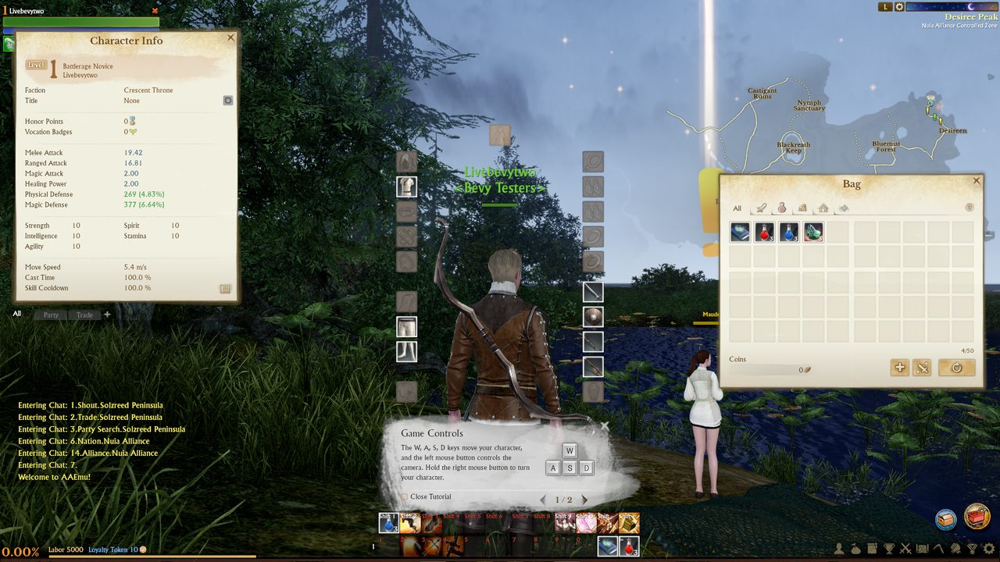
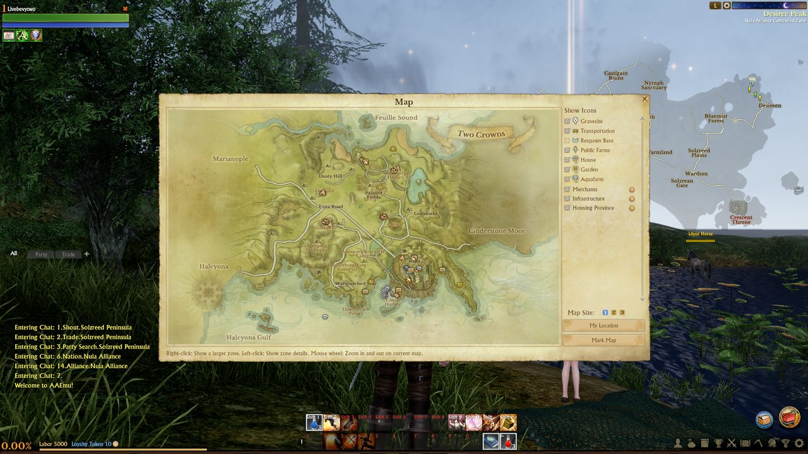

# AAEMU 1.2: an ArcheAge 1.2 client in Bevy

A from-scratch client for **ArcheAge 1.2**, written in Rust on [Bevy](https://bevyengine.org) 0.20. It reads the
original game files (models, animations, terrain, effects, sounds and the original Lua UI) and plays on an
[AAEmu](https://github.com/AAEmu/AAEmu) server: login, world select, character select and create, loading, and in game.
The aim is a client that looks and behaves like the real one and runs fast.

> Work in progress. This is a fan project, not affiliated with XL Games or Kakao Games. No game files are included: you
> need your own ArcheAge 1.2 client and an AAEmu server.



| | |
|---|---|
|  Character select |  Character create |
|  Character info and bag |  World map with service icons |

## What works

- **Screens:** login, world select, character select and create (all four races, both genders) and a loading screen
  with real progress. Everything after login runs the **original Lua UI** from the game's own bytecode.
- **World:** streamed terrain, buildings, vegetation with wind, roads and decals; water, the sea and swimming; sky,
  sun, moons, fog and time of day; sun shafts and eye adaptation; collision; portals and recall.
- **Characters:** all races with faces, hair, presets and dyes; equipment, costumes and weapons; cloth and hair
  physics; animation blending, mounts, other players and NPCs.
- **Combat:** all 231 player skills animated, the game's own particle effects, area targeting, movement skills,
  stealth, hit reactions and damage numbers.
- **HUD (original windows on real data):** action bars, cooldowns, buffs, unit frames and nameplates; bag, bank,
  equipment and character; merchants, repair, enchant, mail, trade and auction house; party, raid, friends, guilds and
  families; duels, quests, the world map and minimap (service, station, respawn and quest-area icons, climate and
  conflict overlays, your ship), chat, skills, crafting, achievements, rankings, battlefields and pets.
- **Audio:** FMOD banks with ambience, zone and combat music, skill sounds, 3D panning and reverb.
- **Performance:** about 70–95 fps at 1920x1080 in the open world on an RX 9070 XT, lower in big towns.

## What's missing

- Ships, vehicles and gliders; mount skills and mounted jumping/swimming.
- Housing construction, decorating and farms end to end; the in-game shop; territory, siege and nation.
- Rendering: FFT ocean waves, glow, some lighting parity for characters and vegetation sprites.
- Windows only.

The full list with evidence is in [`docs/research/remaining.md`](docs/research/remaining.md) and the
[parity ledger](docs/aa-client-parity.md).

## Quick start

**You need:** Windows and a recent Rust toolchain (edition 2024), an ArcheAge 1.2 client (its `game_pak`), and an
AAEmu 1.2 server with its game database `compact.sqlite3` (the client's own copy is encrypted).

```
set AA_PAK=C:\Games\ArcheAge\game_pak
set AA_DB=C:\AAEmu\Data\compact.sqlite3
cargo build -p aa-client
target\debug\aa-client.exe
```

The native cursors are read from `bin32\archeage.exe` next to the `game_pak` (or `AA_EXE`). The dev profile is
already optimized; the first build takes a while because it compiles Bevy.

On the login screen enter your account, password and the server's login address (AAEmu's default is
`127.0.0.1:1237`), then pick a world and a character.

| Key | Action |
|---|---|
| W / S, A / D, Q / E | Forward / back, turn, strafe |
| Space / X | Jump or swim up / swim down |
| Mouse | Left drag orbits, right drag steers, both run, wheel zooms |
| Tab | Next target |
| 1–0, Shift+1–0 | Action bar slots |
| I / C / M | Bag / character / map |

| Option | What it does |
|---|---|
| `--size 1920x1080` | Window size |
| `--mute` | No sound |
| `--account NAME --enter-world` | Logs in and enters the world with the first character |
| `--shot out.png --shot-after 10` | Takes a screenshot after 10 s and exits |
| `--script run.txt [--headless]` | Drives the client from a test script ([docs](docs/aa-client-script.md)) |
| `AA_LOGIN=host:port` | Login server the login screen and `--enter-world` start with |
| `AA_PRESENT=vsync` | Caps the frame rate to the monitor |

Logs go to `%LOCALAPPDATA%\AABevy1.2\logs\` (the last 10 runs); `AA_LOG_FILE` overrides the path, `off` disables it.

## Project layout

| Crate | What it does |
|---|---|
| `aa-pak` | Reads the client's `game_pak` |
| `aa-lua` | Lua 5.1 runtime for the original `.alb` bytecode |
| `aa-ui` | The X2 UI widget toolkit, bound to Lua and rendered in Bevy |
| `aa-cry` | CryEngine formats: DDS, `.mtl`, `.cgf` / `.chr` meshes, materials and shaders |
| `aa-anim` | Animations, character assembly, customization, cloth physics |
| `aa-world` | Terrain, objects, vegetation, water, sky, streaming, collision |
| `aa-fx` | The particle system for the game's effect libraries |
| `aa-audio` | FMOD (FSB5 / FEV) playback and reverb |
| `aa-net` | Login and game protocol client for AAEmu |
| `aa-dev` | Dev harness: window, fps log, screenshots |
| `aa-client` | The application: screens, in-game systems, HUD |

Each crate has notes in `docs/<crate>.md`; research notes are in `docs/research/`.

## Contributing

Contributions are welcome: read [CONTRIBUTING.md](CONTRIBUTING.md) first (no game files, how to test and show a change).

## License

The code is licensed under either of [MIT](LICENSE-MIT) or [Apache-2.0](LICENSE-APACHE), at your option. ArcheAge and
its assets belong to their owners, and none are included here.
