# AAEMU 1.2: an ArcheAge 1.2 client in Bevy

A from-scratch client for **ArcheAge 1.2**, written in Rust on [Bevy](https://bevyengine.org) 0.20. It reads the
original game files (models, animations, terrain, effects, sounds and the original Lua UI) and plays on an
[AAEmu](https://github.com/AAEmu/AAEmu) server. It covers the whole flow: login, world select, character select and
create, the loading screen, and in game. The aim is a client that looks and behaves like the real one and runs fast.

> Work in progress. This is a fan project, not affiliated with XL Games or Kakao Games. No game files are included: you
> need your own ArcheAge 1.2 client and an AAEmu server.

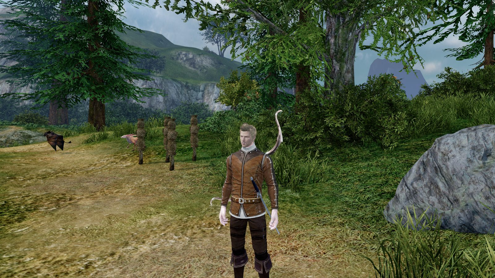

## Screenshots

| | |
|---|---|
| 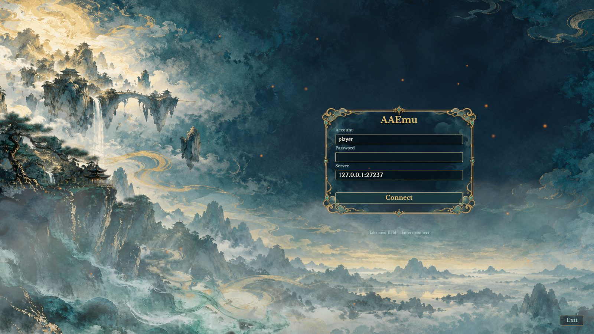 Login screen | 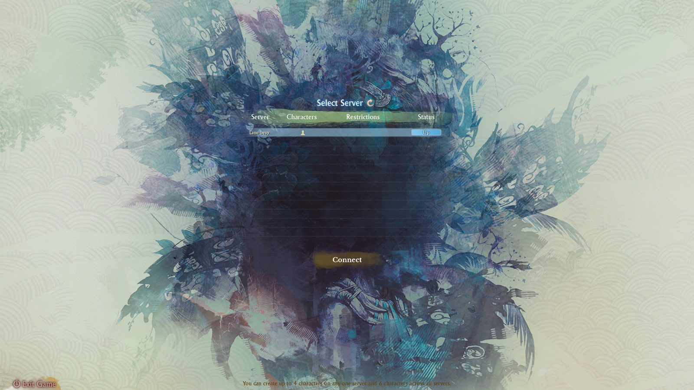 World select (original Lua UI) |
| 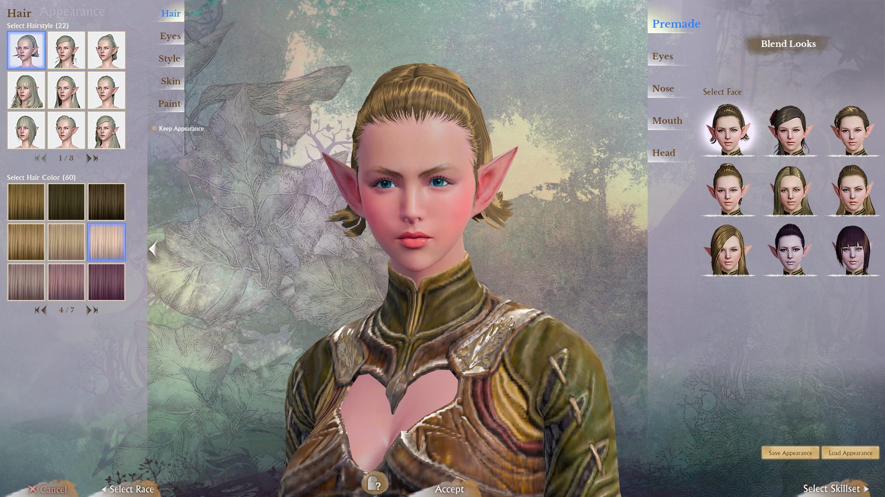 Character create: appearance | 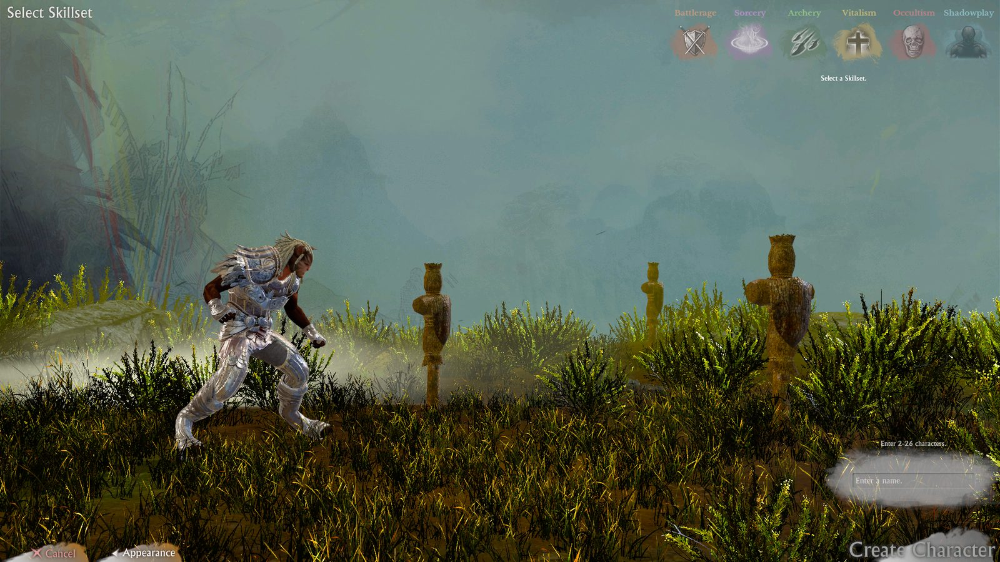 Character create: skillset |
| 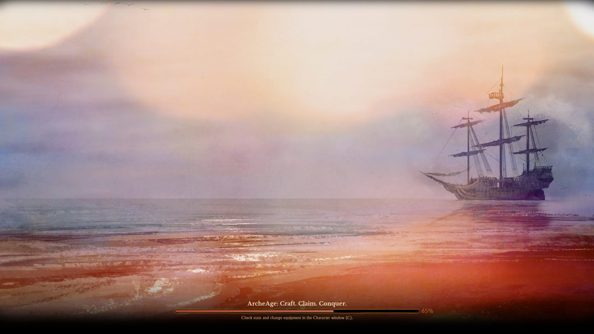 Loading screen | 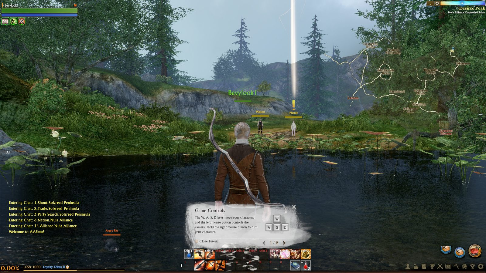 In game with the original HUD |
| 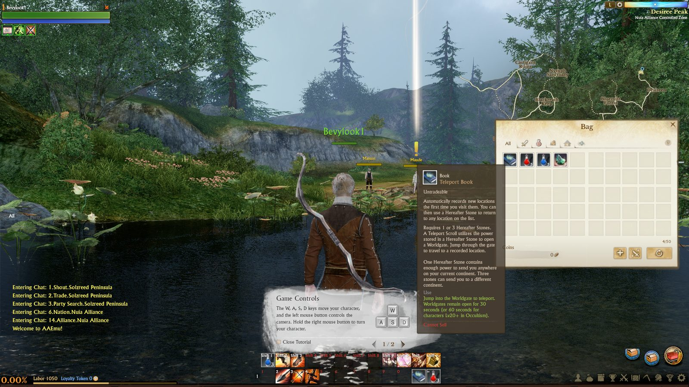 Bag and tooltips | 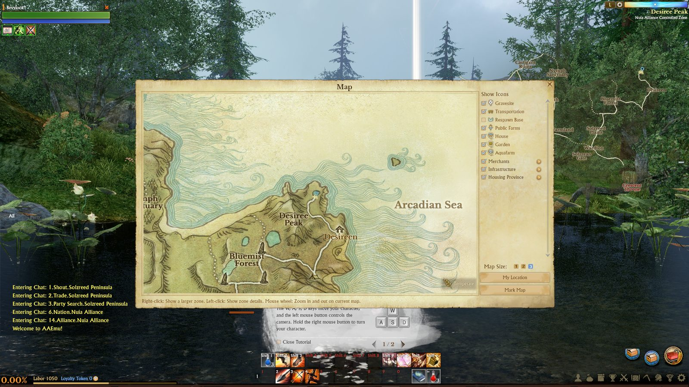 World map |
| 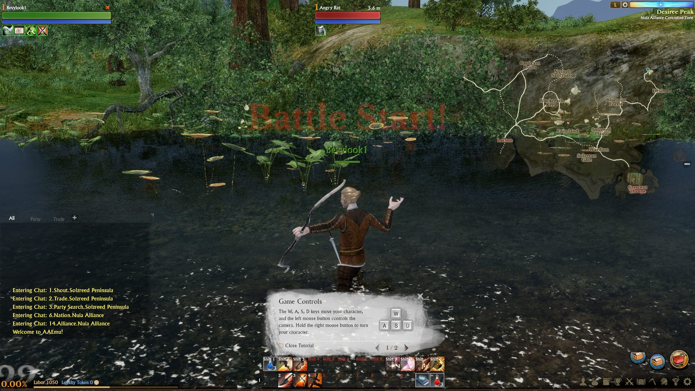 Combat | 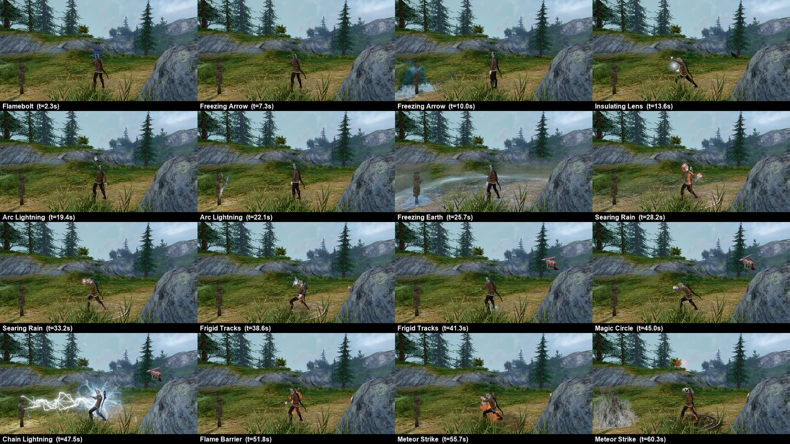 Sorcery skills, one frame each |
| 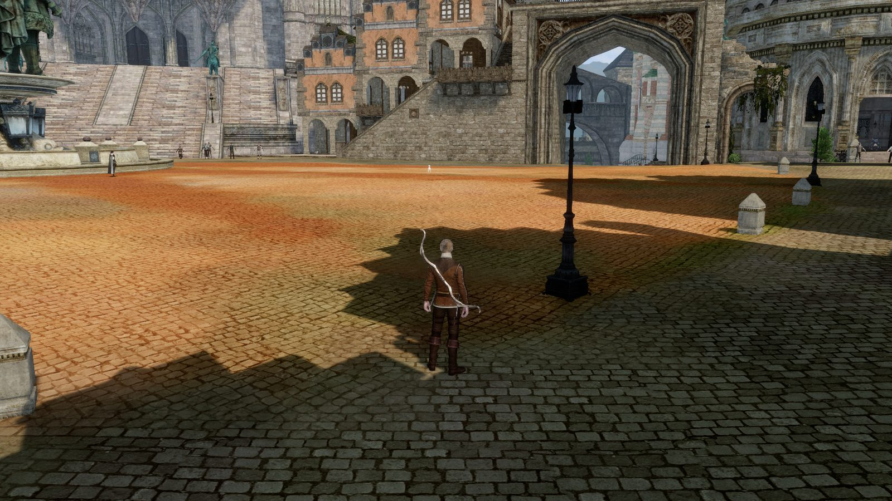 Marianople | 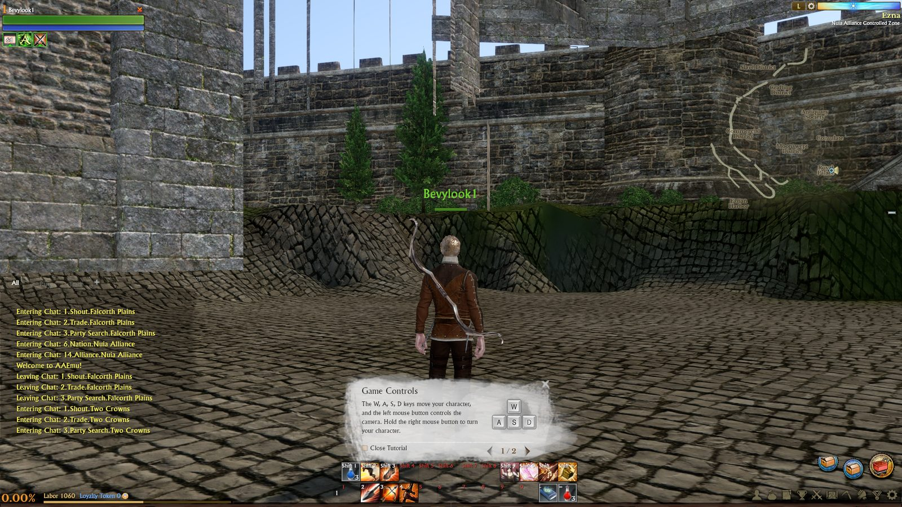 Ezna royal palace |
| 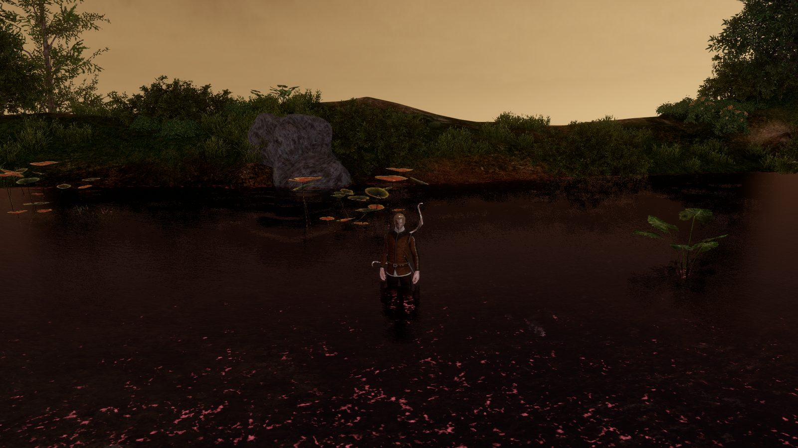 Time of day: golden hour | 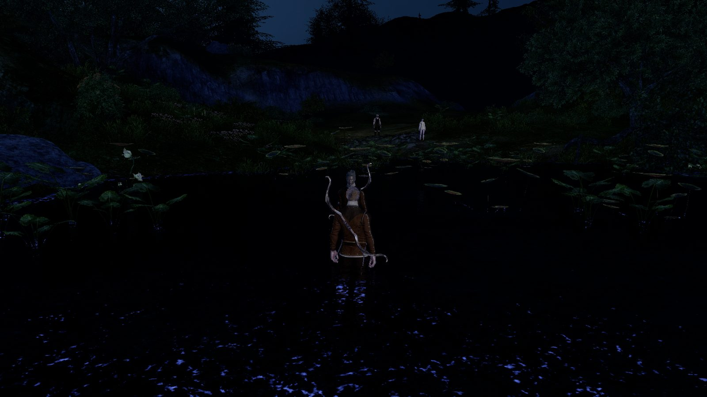 Night |
| 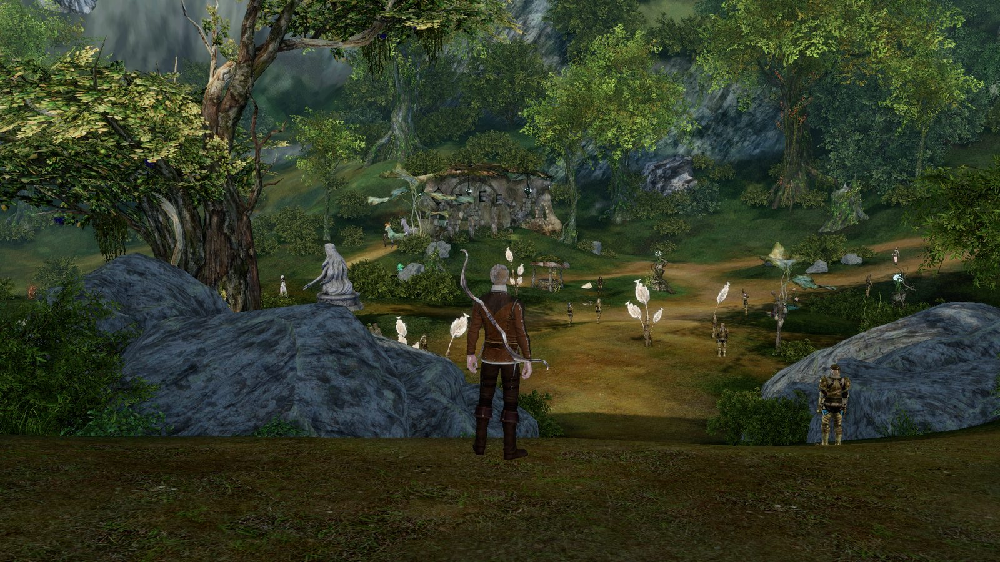 Elf starting area | 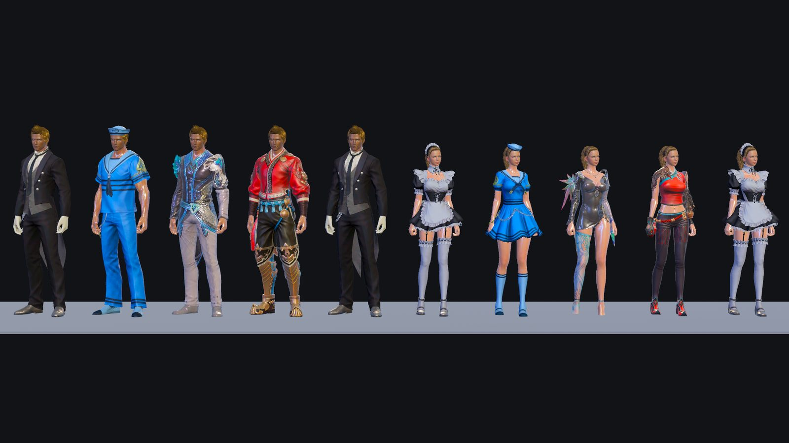 Costumes and armour |

## What works

**Screens**
- A custom login screen (account, password, server address) with animated art. It remembers the account and server
  but never the password.
- World select, character select (3D stage) and character create (all four 1.2 races, both genders, all three steps,
  the server's name rules). These run in the **original Lua UI**, executed from the game's own bytecode.
- A loading screen with real progress. The world, the shaders and your character are built behind it.

**World**
- Streamed terrain with its detail layers, brushes and buildings, vegetation, roads and decals.
- Water, swimming and diving.
- Sky, sun, moons, stars, fog, and the time of day from the game clock.
- Collision with terrain and objects, and a camera that doesn't go through walls.
- Portals: record a location, open a gate with the portal book, walk through it with a loading screen, and Recall.
- Using doodads (F, the F/G/H/J bar, right click): set your recall point at a Memory Tome.

**Characters**
- All races and both genders, with faces, hair, the customization presets and dyes.
- Hair and skin shaders ported from the original CryEngine shaders.
- Equipment: armour pieces trim each other the way the client does, costumes replace the body, and weapons sit on the
  back and hip. Backpacks, tails and beards are drawn.
- Cloth and hair physics: robes, skirts, cloaks and long hair follow the body.
- Animation blending, locomotion, mounts drawn as units, other players and NPCs.

**Combat and skills**
- All 231 player skills have their animations.
- Particle effects from the game's own effect libraries: projectiles, beams, buff auras and ground areas.
- Area targeting with a ground reticle (Meteor Strike, Missile Rain).
- Movement skills: charges, leaps, blinks, knockbacks, knockdowns, Float.
- Stealth, hit reactions, and floating damage numbers timed to the blow.
- The rules for the hard cases (bone table, beams, knockdown, missing controllers) come from reverse-engineering
  the 1.2 client.

**HUD (original windows on real data)**
- Action bars that grey out skills you can't use, cooldowns, buffs, unit frames and nameplates.
- Bag, bank, equipment and the character window.
- Merchants, repair, enchant, mail, trade.
- Party and raid, friends, guilds and families.
- Duels (challenge, countdown, result), titles over the name plate, emotes and speech bubbles.
- Quests, the world map and minimap, chat, skills, crafting, achievements, rankings, battlefields, pets.

**Audio:** FMOD sound banks are decoded and played, including ambience, music, skill sounds and reverb.

**Performance:** about 70–95 fps at 1920x1080 in the open world on an RX 9070 XT, and lower in big towns.

This list is what works, not a parity claim: see [`docs/aa-client-parity.md`](docs/aa-client-parity.md) for the unfinished systems and their evidence.

## What's missing

- **Transport:** owning and riding mounts, ships, vehicles and gliders.
- **Housing:** building, placing and decorating, and farms.
- **Auction house, in-game shop, territory, siege and nation:** aa-net has the auction protocol, but there's no window
  yet. The rest have no client side.
- **Doodads:** using them works, but there's no gathering or farming UI yet, phase models (a doodad changing look)
  aren't drawn, and doodads placed by other players are missing.
- **Teleports:** the player-placed Navi signs are only unit-tested, and world gate 304 (the White Dress Portrait in
  Haranya) is missing from the server's data.
- **World rendering:**
  - Distant objects (no impostors, so buildings vanish beyond 1 km).
  - Vegetation wind.
  - Some post effects: sun shafts, eye adaptation.
  - Sea foam and caustics.
- **Characters:** faces are flatter than the real client in character create, and heeled shoes sit a little low.
- **Skills:** a handful of effects are dimmer than the real client (Summon Wraith's cloud). Missile Rain's arrow
  rain is missing from the game data itself.
- **Options:** the graphics settings are not applied yet, and key bindings can't be changed.
- **Performance:** big towns (Marianople, about 38 fps).
- **Portability:** it is developed and tested on Windows only.

The full list, with evidence and sizes, is in [`docs/research/remaining.md`](docs/research/remaining.md).

## Quick start

**You need:**
- Windows and a recent Rust toolchain (edition 2024; developed on Rust 1.99).
- An ArcheAge 1.2 client. The client reads its `game_pak` file.
- An AAEmu server for 1.2, and its game database `compact.sqlite3`. The client's own copy of that database is
  encrypted, so it reads the server's.

**Point the client at your files** (these are the defaults):
```
set AA_PAK=D:\AA1.2\game_pak
set AA_DB=D:\aaemu-live\rs-game\Data\compact.sqlite3
```
The native cursors are read from the original `archeage.exe`. Set `AA_EXE` to its path, or leave it unset and the
client uses `bin32\archeage.exe` next to the `game_pak` named by `AA_PAK` (the 1.2 layout). Without either,
cursors fall back to `D:/aa-re/client12/bin/archeage.exe`; a missing file leaves the OS cursor in place.

**Build and run**, from the repository root:
```
cargo build -p aa-client
target\debug\aa-client.exe
```
The dev profile is already optimized. The first build takes a while, because it compiles Bevy.

**Play:**
1. On the login screen, enter your account, your password and the server's login address, for example
   `127.0.0.1:1237` (AAEmu's default). Tab moves between the fields, Enter connects.
2. Pick a world, then a character, or create one.
3. Controls follow the 1.2 defaults:

| Key | Action |
|---|---|
| W / S | Forward / back |
| A / D | Turn |
| Q / E | Strafe |
| Space | Jump, or swim up |
| X | Swim down |
| Mouse | Left drag orbits the camera. Right drag steers. Both buttons run. Wheel zooms. |
| Tab | Next target |
| 1–0, Shift+1–0 | Action bar slots |
| NumLock | Auto-run |
| . | Toggle walking |
| I / C / M | Bag / character / map |

**Handy options:**

| Option | What it does |
|---|---|
| `AA_PRESENT=vsync` | Caps the frame rate to the monitor; it helps over remote desktop |
| `--size 1920x1080` | Window size |
| `--mute` | No sound |
| `--account NAME --enter-world` | Skips the menus: logs in and enters the world with the first character |
| `--shot out.png --shot-after 10` | Takes a screenshot after 10 s and exits |
| `--script run.txt [--headless]` | Drives the client from a line-based test script, optionally without a window ([`docs/aa-client-script.md`](docs/aa-client-script.md)) |

## Project layout

| Crate | What it does |
|---|---|
| `aa-pak` | Reads the client's `game_pak` |
| `aa-lua` | Lua 5.1 runtime for the original `.alb` bytecode |
| `aa-ui` | The X2 UI widget toolkit, bound to Lua and rendered in Bevy |
| `aa-cry` | CryEngine formats: DDS, `.mtl`, `.cgf` / `.chr` meshes, materials and shaders |
| `aa-anim` | Animations (`.caf`, `.dba`), character assembly, customization, cloth physics |
| `aa-world` | Terrain, objects, vegetation, water, sky and time of day, streaming, collision |
| `aa-fx` | The particle system for the game's effect libraries |
| `aa-audio` | FMOD (FSB5 / FEV) playback and reverb |
| `aa-net` | Login and game protocol client for AAEmu |
| `aa-dev` | Dev harness: window, fps log, screenshots, frame recording |
| `aa-client` | The application: screens, in-game systems, HUD |

Each crate has notes in `docs/<crate>.md`. Research and reverse-engineering notes are in `docs/research/`.

## License

The code is MIT or Apache-2.0, at your option. ArcheAge and its assets belong to their owners, and none are included
here.
