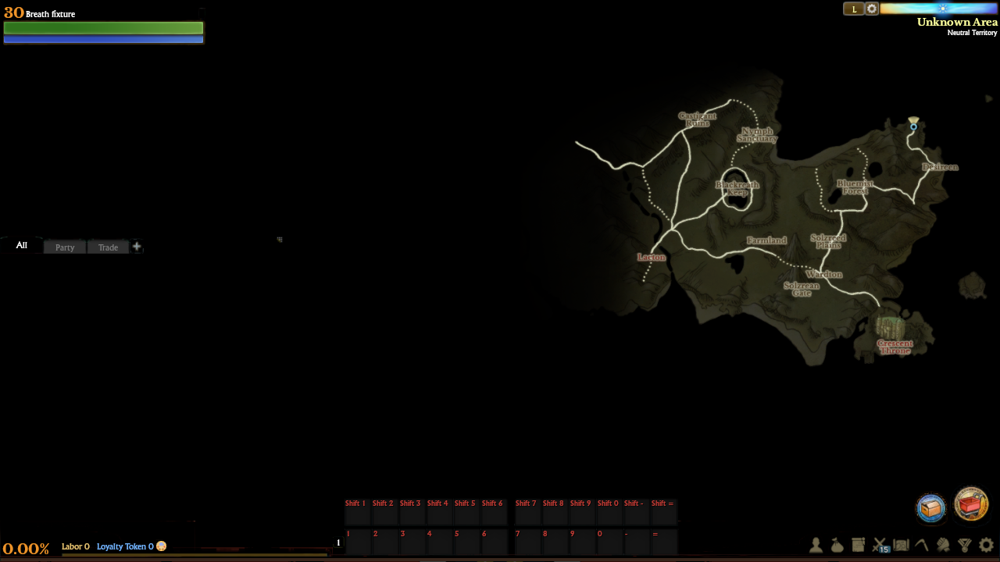
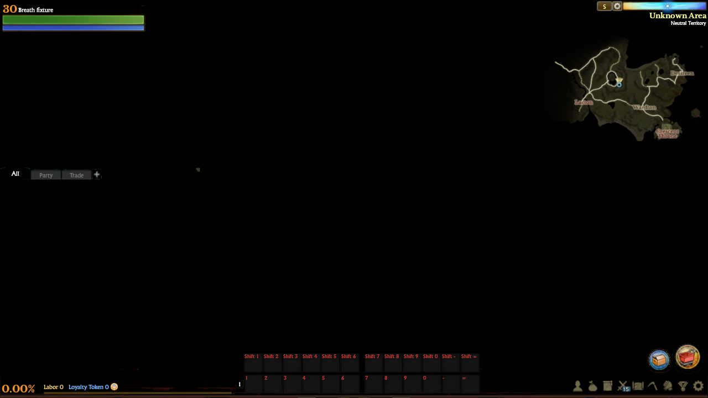

# Native roadmap options

The original large translucent roadmap is intentional. Original Lua defaults to
size 3 (`L`), visible, with NPC display off. It owns the 926×556 window, the size
button and the 50/70/100-percent registered map art. The translucent pixels are in
the original DDS. No extent, opacity, crop or clipping change is part of this work.

The app previously kept these options only in `markers.lua`. It now reads and
replaces `roadmap_option` in the existing active-character type-5
`common_server_data_1` tree. Achievement tracing and unknown root siblings share
that tree and survive roadmap updates. The existing leave path saves the whole
tree before leaving; the option setter sends no packet and claims no server ACK.
Unsupported/truncated payloads keep the existing protection against overwriting
opaque data, and the character identity guard remains in place.

Original `roadmapSizeButton:Init()` applies received options, including data that
arrives after construction. A pending refresh survives HUD suspension and runs
when the HUD returns. Construction and local original control handlers consume
their already-applied changes without an extra refresh. Stage rebuilds query the
same current tree. No replacement UI event or frame-by-frame reinitialization is
introduced.

## Executed native contract

`39443a70` reads category 5 and the first `roadmap_option` section. An absent or
empty section returns nil; missing fields remain absent for original Lua defaults.
Size uses native decimal-prefix, wrapping i32 parsing and f32 script-number
conversion. Visibility reads true only from the exact lowercase `true` leaf.

The shipping getter has a deterministic bug: after a successful NPC bool read,
`39443b63..6e` passes the previous **size** local to the numeric table setter.
Thus complete saved size 1–3 records return numeric `npcShow=1..3`, even when the
stored bool is false. Executing the original option bytecode and native checkbox
path confirms that Init checks NPC display and may rewrite the in-memory field
as boolean true. This behavior is preserved.

When NPC data exists without a readable size, the native result depends on
uninitialized stack contents. The app omits that uncertain field. This is an
explicit compatibility limit, not a claim that the original returns nil or zero.

`39443bc0` clears the first roadmap subtree, then accepts numeric size and strict
boolean visible/NPC fields in order. It truncates f32 size toward zero, retaining
native i32-indefinite behavior for out-of-range values. Booleans serialize as
`true`/`false`; numeric substitutes are omitted. Root siblings survive.

The [retained evidence](../tools/evidence/roadmap/executed-report.txt) covers 35
getter cases, 50 setter cases, bool/numeric boundaries, and 26 original Lua
controls. x2game and xlcommon execute in isolated Unicorn memory; original Lua
bytecode executes in Lua 5.1. Allocation, script-table primitives and specified UI
endpoints are controlled. These are CPU goldens, not live-client recordings.

Reproduce the original instruction and bytecode probes from the repository root:

```powershell
python -I tools/roadmap_native_oracle.py
python -I tools/roadmap_option_oracle.py
```

The probes require the pinned read-only originals and existing research Python
dependencies described in their source. Outputs go to ignored audit scratch.

## Validation and limits

Settings checkpoint: `2072072`.

The before test reproduced a saved small map remaining large after construction.
The targeted tests exercise original controls, receipt timing, stage recreation,
suspension, strict fields, native goldens, sibling preservation and unsafe data.
All six pass, including four normally ignored original-stage checks. The final
default client suite passes 635 checks with 67 ignored. Main and example builds
pass. One Clippy run completes with existing warnings and no diagnostics in the
new roadmap modules. Independent follow-up review found no remaining P1/P2 in
this scope; it did not independently execute tests.

```powershell
cargo test --locked -p aa-client --bin aa-client roadmap_ -- --include-ignored
cargo run --locked -p aa-client --example roadmap -- --before --map-size 1 --size 1280x720 --shot shots/resume/roadmap/before.png --shot-after 12
cargo run --locked -p aa-client --example roadmap -- --map-size 1 --size 1280x720 --shot shots/resume/roadmap/small.png --shot-after 12
```

The before visual control uses the final binary and the same saved tree while
omitting its former missing projection into the controls. It is not a historical
binary or retail screenshot. Final capture metrics are recorded with the evidence.

| Saved small setting, former projection | Restored through original controls |
|---|---|
|  |  |

All five inspected 1280×720 captures exit successfully, with zero warnings/errors
and 47 pipelines, none waiting. L, S, M and hidden controls render as expected;
the final L PNG is byte-identical to the before L control. The S pair changes
166,138 RGBA pixels. These are offline HUD fixtures on a black clear background.

Observed FPS ranges: before L 556.1–574.9, restored S 405.4–565.4, M 459.4–547.1,
L 361.7–556.9, hidden 395.5–563.5. Shared activity prevents a causal performance
conclusion. [Validation](../tools/evidence/roadmap/validation.json) records source,
binary and PNG hashes, commands and the full capture manifest.

The repeated-receipt regression also preserves live NPC dots: a numeric NPC
value omitted by strict serialization must not disable the still-checked option.
Only an admitted Boolean NPC field changes the app's dot-computation gate.

Automatic approval review rejected exact-file cleanup of the 114.3 MiB roadmap
QA executable with “blocked by policy.” It is retained without a cleanup retry.

The original English large map requests 532 texel rows from a 516-row DDS. Exact
bottom-edge sampling remains unaudited and unchanged. Small/medium centre
projection is addressed separately below. Marker admission, every locale,
native image sampling, and live server relog persistence are not certified by
the settings checkpoint alone.

## Selected-size centre projection

Original `392ab830` projects world coordinates against the **current Map extent**.
Player `392af8b0`, ordinary NPC and given-quest paths use the same centres.
The app previously normalized every point against the L frame, even while S or M
art was selected. Original offsets/crops are not exactly proportional: at the
Solzreed centre this introduced approximately `(1.423,-5.113)` UI-unit drift for
S and `(2.669,-6.540)` for M.

The private shared Lua helper now uses `roadmap:GetExtent()` and the actual
selected 50/70/100 frame:

```text
image_u = (world_u * MapWidth  - selected_offset_x) / selected_image_width
image_v = (world_v * MapHeight - selected_offset_y) / selected_image_height
```

The frame data contains all 271 original plain-number registrations; the 11
locale-controlled registrations still use original `FORM_ROAD_MAP_LIST` values.
Original constant arguments retain precedence over unused locale entries.
Player, ordinary markers and party-ping display share the conversion. City
selection continues to use its own sub-zone rectangle. Marker cache keys include
current size, dimensions and frame, so unchanged contacts update after a resize.

The previous 100-frame art-box **admission** decision is deliberately retained
separately from the corrected centre. Native category/exploration/visibility and
edge admission require their own proof. No icon artwork, dimensions, crop,
opacity, toolkit meaning or network API changes here. Only original S/M/L extent
pairs are admitted by the frame selector.

Validation passes: 204 reexecuted original x86 paths across 51 zone/city cases;
all 282 original frames; player/NPC/quest positions within 0.001 UI units of the
native numeric oracle; unchanged legacy marker admission and resize invalidation
with unchanged contacts. The final source guard checks all 271 constant versus
11 locale registrations and locale precedence. Seven targeted roadmap checks,
the existing party-ping echo check, and 636 default client checks pass (67 ignored).
One projection-task Clippy run completes with existing warnings and no diagnostic
in the new test/fixture. The final test-only locale guard passed afterward;
Clippy was not rerun. Main and example builds pass. Independent static review
found no introduced P1/P2.

All eight inspected GPU controls exit 0, with zero warnings/errors and 47 pipelines,
none waiting. At 1280×720, the S pair changes 348 RGB pixels and M 358, confined
to the player-marker region. L is byte-identical. Corrected live-map midpoint
drift is under 0.00005 UI units at UI scales 0.85 and 1.0; native pixel snapping
and the Lua/native float bridge remain separate limits.

| Former fixed-L projection on S art | Selected-S projection |
|---|---|
|  |  |

Observed FPS at 1280×720: S 487.3–593.1 before / 399.1–586.6 after;
M 366.9–550.3 / 364.2–432.3; L 478.0–586.6 / 456.9–593.2.
1920×1080 after controls: S 486.2–595.8, M 490.8–596.8. These are shared-machine
observations, without an isolated performance claim.

Reproduce the independent native projection probe and targeted app check:

```powershell
python -I tools/roadmap_projection_native.py
cargo test --locked -p aa-client --bin aa-client roadmap_projection_ -- --nocapture
cargo run --locked -p aa-client --example roadmap -- --centre --projection-before --map-size 1 --size 1280x720 --shot shots/resume/roadmap-projection/before.png --shot-after 12
```

Omit `--projection-before` for the corrected control. Both use the final binary
and original artwork at the same synthetic world point. Source/binary hashes,
numeric drift, full commands and PNG identities are in the
[projection validation](../tools/evidence/roadmap/projection/validation.json).
No native GPU capture, full marker classification or live-world parity is claimed.
Exact-file cleanup of the 114.3 MiB projection QA copy was also rejected by
automatic approval review with “blocked by policy”; it remains without a retry.
