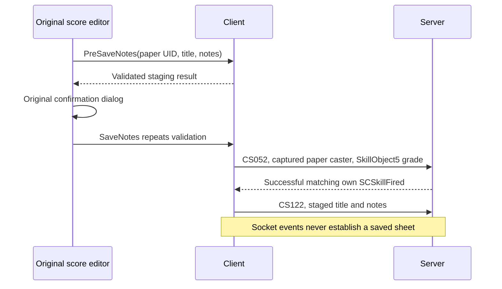

# Original player music

The composition editor uses the original `x2ui/music/user_music.alb` window and callbacks.
Music Paper27902 opens it locally. The app supplies the seven visible proficiency rows,
current Composition33 proficiency, equipped instrument program, text validation, local
preview, and the captured Compose cast. It does not acknowledge a successful save locally.

The item UID remains a decimal string through Lua, including values above2^53. The cast
retains the complete received paper at its physical main-bag slot; the network session
checks it again at transmission. The item grade/maker fields are independent of the
composition grade. The upload requires an accepted cast write followed by a successful
received own item-caster fire, with its timeline when one was reported. A rejected,
canceled, duplicate, other-caster, failed-result or previous-character callback cannot
produce a second upload. Received item changes remain authoritative.

Preview compiles MML locally and renders `sounds/default.dls` on a worker into the existing
audio engine's PCM path. Closing the editor, StopPlayNotes or leaving the game cancels its
generation and stops its voice. A stale render result is discarded. Two render jobs are
allowed, including canceled jobs still finishing; each result holds at most one clip.
The original bank is parsed once. PCM caps remain240 seconds and5,760,000 mono samples;
the synth adds a0.5-second release tail. No temporary MIDI/WAV file or second audio device
is used. Preview emits no music packet, including End. Lua receives an application preview
token; it is not the audio engine's native Voice ID. A busy worker or asynchronous failure
is logged; native synchronous failure timing is not claimed.

Native source evidence:

| Behavior | Original addresses |
|---|---|
| Paper opens OPEN_MUSIC_SHEET locally |394eaac0, impl26 |
| PreSave validates and stages; Save repeats and casts |390799e0 /39079640 /39083c60 |
| First music_note_limits step covering the scalar text length |39081f80 |
| Equipped instrument and proficiency quality |39083960 |
| UTF-8 scalar count, including supplementary characters |xlcommon3301b000 |
| Received skill-fired action97 uploads staged notes |391d58a0 →391d5931 →3939b010 →3939b5fa |
| Local preview / stop |39079b90 /390797f0 |

`tools/user_music_oracle.py` executes34 original-code cases: six UTF-8 length cases and
28 exact f32 quality cases. The quality calculation always looks up grade0's upper limit,
then subtracts the previous grade's threshold for a nonzero grade. It does not substitute
the current grade's upper limit. Values at least1 are perfect notes in the native compiler;
the app maps them to1 for the bounded aa-midi API. MML compilation itself has54 original
executed compiler fixtures in aa-midi; the captured cast has22 writer fixtures in aa-net.

Five focused client checks pass, including the two original-asset checks explicitly run
with `--include-ignored`. They cover actual Sample and Save buttons, the original
confirmation's Cancel/OK paths, Unicode limits, captured UID/slot/grade/maker fields,
duplicate and invalid fire rejection, generation cancellation and original-bank PCM.
The integrated music checkpoint passes599 tests with42 optional ignores in70.51 seconds.
Chat-transfer integration is checked in its own subsequent slice. The isolated `user_music`
example uses explicit received paper/instrument/proficiency fixtures and has no Session.
`--before` shows the prior item-use result (no editor); the default shows the original
editor. `--preview` presses its actual Sample button. This is an application control
comparison, not a paired screenshot from the original game client.

Inspected1280×900 captures: `shots/resume/music/editor-before.png` and `editor-after.png`.
Observed aa-dev FPS ranges:289.0–366.5 before and293.3–299.9 after, on the shared machine.
Both self-closed and logged no Lua/render/music errors or warnings. Screenshot runs are
muted by the existing unattended audio policy; this is not a listening or town-FPS claim.

Still open: stored-sheet tooltip/cache lookup and persistence; received normal/placed
performance callbacks and broadcasts; exact piano/percussion buff overrides; native
394e4960/opening buff-tag gates; exact proficiency modifiers/RNG stream and FMOD synthesis,
MIDI mixer routing and synchronous preview failure behavior; live composition settlement.
The current preview uses the music slider and2D PCM as explicit application policy.
Native playing/cache/pause callbacks and own natural voice End must remain distinct from
preview. Server [PR44](https://github.com/NickMesser/AAEmu/pull/44) fixes independent
CS123 tooltip/buff-only flags and uncached replies; its isolated lane validated7 response
and buff cases, not composition or audio playback. It is not deployed to the existing
bevy server. See also `aa-net.md`, `aa-midi.md` and `aa-audio.md` for backend limits.

## Received playback investigation (2026-10-23)

`tools/user_music_playback_oracle.py` executes 37 original instruction cases from
the SHA-256-pinned 1.2 DLL. Results are retained at
`data/extract/aa-client/user-music-playback-native-20261023.json`. These are native
research checks, not implemented client playback checks.

- `391e167a..391e16a0` passes the SC1e0 note ID to `39082260` by **signed** i32-to-i64
  extension, with independent tooltip, title, notes and length arguments. The ten
  cases include the signed boundary and both tooltip values.
- `391e15ea..391e160f` passes received MIDI length, actor, author and MIDI bytes to
  `390824e0`. The three cases preserve the full 32,768-byte boundary. This callback
  starts received playback; it does not compile notes or send CS121.
- `39084195..39084211` mutes another player's existing voice only when the disable
  option returns exactly 1. Own playback remains at unity for that per-voice factor;
  missing option objects and other numeric values leave it at unity. The 24 cases
  cover own/other actors and both current-player/fallback identity paths.

The surrounding recovered `390846d0` resolves an actual actor before admitting a
voice, replaces that actor's previous voice, uses distances 30/50 and sound group 8,
then refreshes its option gain. `390844a0` follows actor positions and sends CS124
when an own tracked voice disappears. `390840f0` removes a stopped voice directly.
The next implementation must preserve these distinctions: muted/refused/failed PCM
submissions and local preview completion cannot stand in for a normal performance's
natural voice end. The exact group-8 mixer route still needs a coordinated audio
implementation; the existing editor preview's Music category is documented above.

`391e1640` calls the cache callback directly. In `39082260`, `39082200` removes the
note ID from the pending list; it is not a deferred play callback. Cache misses and
hits in `39082550` therefore need their actual request/buff sequence implemented
separately, without treating a received note or successful socket write as playback.
