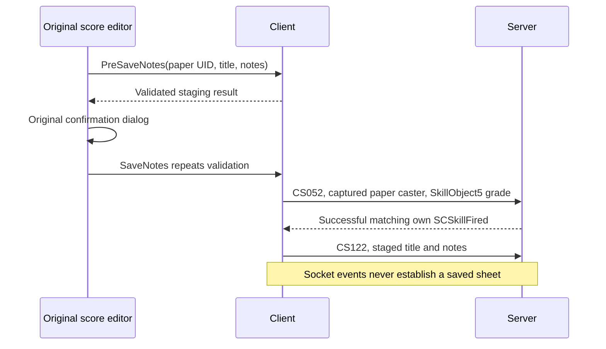

# Original player music

The composition editor uses the original `x2ui/music/user_music.alb` window and callbacks.
Music Paper27902 opens it locally. The app supplies the seven visible proficiency rows,
current Composition33 proficiency, equipped instrument program, text validation, local
preview, and the captured Compose cast. It does not acknowledge a successful save locally.

The item UID remains a decimal string through Lua, including values above2^53. The cast
retains the complete received paper at its physical main-bag slot; the network session
checks it again at transmission. The item grade/maker fields are independent of the
composition grade. The upload requires an accepted cast write followed by a successful
received own item-caster fire, with its timeline when one was reported. A rejected,
canceled, duplicate, other-caster, failed-result or previous-character callback cannot
produce a second upload. Received item changes remain authoritative.

Preview compiles MML locally and renders `sounds/default.dls` on a worker into the existing
audio engine's PCM path. Closing the editor, StopPlayNotes or leaving the game cancels its
generation and stops its voice. A stale render result is discarded. Two render jobs are
allowed, including canceled jobs still finishing; each result holds at most one clip.
The original bank is parsed once. PCM caps remain240 seconds and5,760,000 mono samples;
the synth adds a0.5-second release tail. No temporary MIDI/WAV file or second audio device
is used. Preview emits no music packet, including End. Lua receives an application preview
token; it is not the audio engine's native Voice ID. A busy worker or asynchronous failure
is logged; native synchronous failure timing is not claimed.

Native source evidence:

| Behavior | Original addresses |
|---|---|
| Paper opens OPEN_MUSIC_SHEET locally |394eaac0, impl26 |
| PreSave validates and stages; Save repeats and casts |390799e0 /39079640 /39083c60 |
| First music_note_limits step covering the scalar text length |39081f80 |
| Equipped instrument and proficiency quality |39083960 |
| UTF-8 scalar count, including supplementary characters |xlcommon3301b000 |
| Received skill-fired action97 uploads staged notes |391d58a0 →391d5931 →3939b010 →3939b5fa |
| Local preview / stop |39079b90 /390797f0 |

`tools/user_music_oracle.py` executes34 original-code cases: six UTF-8 length cases and
28 exact f32 quality cases. The quality calculation always looks up grade0's upper limit,
then subtracts the previous grade's threshold for a nonzero grade. It does not substitute
the current grade's upper limit. Values at least1 are perfect notes in the native compiler;
the app maps them to1 for the bounded aa-midi API. MML compilation itself has54 original
executed compiler fixtures in aa-midi; the captured cast has22 writer fixtures in aa-net.

Five focused client checks pass, including the two original-asset checks explicitly run
with `--include-ignored`. They cover actual Sample and Save buttons, the original
confirmation's Cancel/OK paths, Unicode limits, captured UID/slot/grade/maker fields,
duplicate and invalid fire rejection, generation cancellation and original-bank PCM.
The integrated music checkpoint passes599 tests with42 optional ignores in70.51 seconds.
Chat-transfer integration is checked in its own subsequent slice. The isolated `user_music`
example uses explicit received paper/instrument/proficiency fixtures and has no Session.
`--before` shows the prior item-use result (no editor); the default shows the original
editor. `--preview` presses its actual Sample button. This is an application control
comparison, not a paired screenshot from the original game client.

Inspected1280×900 captures: `shots/resume/music/editor-before.png` and `editor-after.png`.
Observed aa-dev FPS ranges:289.0–366.5 before and293.3–299.9 after, on the shared machine.
Both self-closed and logged no Lua/render/music errors or warnings. Screenshot runs are
muted by the existing unattended audio policy; this is not a listening or town-FPS claim.

The initial checkpoint left stored-sheet cache, normal callbacks and broadcast playback open;
those are implemented in the integration below. Remaining gaps include native394e4960/opening buff-tag gates and placed-instrument interaction,
proficiency modifiers/RNG stream, FMOD synthesis and synchronous preview failure behavior,
and live composition settlement. Own preview and performance share the native tracking slot;
natural preview completion also sends End, as the later executed lifecycle proof establishes. Server [PR44](https://github.com/NickMesser/AAEmu/pull/44), now merged into `rust-rewrite`, fixes independent
CS123 tooltip/buff-only flags and uncached replies; its isolated lane validated7 response
and buff cases, not composition or audio playback. Deployment to the existing bevy server is not assumed; verification uses an isolated lane. See also `aa-net.md`, `aa-midi.md` and `aa-audio.md` for backend limits.

## Received playback investigation (2026-10-23)

`tools/user_music_playback_oracle.py` executes 37 original instruction cases from
the SHA-256-pinned 1.2 DLL. Results are retained at
`data/extract/aa-client/user-music-playback-native-20261023.json`. These are native
research checks, not implemented client playback checks.

- `391e167a..391e16a0` passes the SC1e0 note ID to `39082260` by **signed** i32-to-i64
  extension, with independent tooltip, title, notes and length arguments. The ten
  cases include the signed boundary and both tooltip values.
- `391e15ea..391e160f` passes received MIDI length, actor, author and MIDI bytes to
  `390824e0`. The three cases preserve the full 32,768-byte boundary. This callback
  starts received playback; it does not compile notes or send CS121.
- `39084195..39084211` mutes another player's existing voice only when the disable
  option returns exactly 1. Own playback remains at unity for that per-voice factor;
  missing option objects and other numeric values leave it at unity. The 24 cases
  cover own/other actors and both current-player/fallback identity paths.

The surrounding recovered `390846d0` resolves an actual actor before admitting a
voice, replaces that actor's previous voice, uses distances 30/50 and sound group 8,
then refreshes its option gain. `390844a0` follows actor positions and sends CS124
when an own tracked voice disappears. `390840f0` removes a stopped voice directly.
The next implementation must preserve these distinctions: muted/refused/failed PCM
submissions cannot stand in for an admitted voice's disappearance. Later execution proves
that preview and received own voices share this same completion behavior. The exact group-8 route was subsequently recovered as described below.

`391e1640` calls the cache callback directly. In `39082260`, `39082200` removes the
note ID from the pending list; it is not a deferred play callback. Cache misses and
hits in `39082550` therefore need their actual request/buff sequence implemented
separately, without treating a received note or successful socket write as playback.

## Dedicated MIDI volume integration

Native sound semantic 8 routes through `s_MIDIVolume` and a cached master factor independently
of BGM and SFX. The client preview now selects `Category::UserMusic`; sound option 40
updates `Volumes::user_music`, default 1. Option 41 retains the native other-player mute
preference; own preview remains exempt. Normal and broadcast consumers use this same route
in the stored-score integration below.

The original option table at `39ac62c8` maps 35/36/37/40/41 to master/BGM/SFX/MIDI/other
mute. CrySound `360310c0`, `36050530` and `360446a0` establish independent MIDI gain,
cached MIDI clamps and master-to-game-MIDI propagation. Executed source cases and the
existing-device track validation are retained by `aa-audio`. This proves the pre-device
coefficient. Native FMOD downstream master routing is being audited separately; the
current client applies master once and does not claim total native master-gain parity.
Nonunity source/global scales and exact FMOD synthesis also remain open.

An actual Lua-hook regression sets BGM and SFX to zero, MIDI to .3 and master to .4,
then checks the independent .12 MIDI gain. It also checks other-mute values 2/1 and
ignores nonfinite updates. PCM request defaults, cancellation and completion remain
unchanged. The earlier no-wire preview policy was corrected after original entry/tree/update
execution proved that an admitted own preview's natural disappearance sends CS124.

Validation: all 11 focused mixer/music/chat checks pass, including original-bank rendering.
The expanded saved-option startup/reset check passes on the final source; nine existing
settings checks also pass, with one existing optional check ignored. Audio's full device-
inclusive suite passes 76 checks. These validate the dedicated route, not stored-sheet
playback or live composition settlement. No new visual/FPS claim applies to this audio slice.

## Stored-score cache and performance integration (2026-10-23)

The application now retains received scores outside the read-only game installation, under
the selected account's settings path with the `.music` extension. Files are separated by
world byte and native low32 note key. Executing the original Windows formatter corrected an
earlier full64-key assumption: `%016lx` consumes low32 and pads it to16 hex digits. Pending
requests and outgoing note IDs still preserve full64; SC1e0 IDs sign-extend from i32 for
pending removal. The resulting pending-ID mismatch at the signed boundary is preserved,
while the saved low32 alias remains readable. The backend uses bounded JSON files instead
of native LevelDB; invalid or oversized files are cache misses. One scratch score is retained
in memory. Failed disk writes still remove the matching pending ID and stage received notes.

A cold tooltip/use sends exactly one CS123 with its actual tooltip flag and buff-only=false.
An overlapping query for the same full64 ID is deduplicated. A tooltip hit is local. A use hit
stages the cached text and sends `(false,true)` with the original requested full64 ID. Receiving
a score only saves, removes pending and stages text: no automatic retry, buff, cast, MIDI or
End. An unknown empty response has no correlation ID and does not erase an arbitrary request.

Bag and item-link tooltips carry detail8 as a decimal string through Lua, preserving IDs above
2^53. Original bag `UpdateIcon` and `OnEnter` omit the flags argument and therefore request full
extras; present nil/boolean/nonnumeric flags initialize zero, and only effective -1 includes
the stored-score section. Action slots provide a query-time tooltip closure. Receiving a score
does not mutate an already open tooltip: original rehover/hovered bag update queries again.
There is no frame polling or invented receipt notification.

Successful own nonzero-timeline SkillStarted callbacks inspect the actual catalog join
`skill_effects -> effects(actual_type='SpecialEffect') -> special_effects`. Action93 compiles
staged notes and sends CS121; action94 sends CS124, including both pause22214 and close22217.
No application-method filter is used: method3 means SourceOnce, a target mode. Unit, Item and
Mount casters resolving to the actual own actor are accepted; Unk1/Doodad casters do not enter
this native path. Existing successful matching item SkillFired/action97 uploads remain separate.
Note receipts and skill callbacks run inside the receipt-ordered item dispatcher, alongside a
private received Artistry state. An earlier Started callback cannot use a later note, equipment
replacement or proficiency receipt in the same batch, even though the HUD's display snapshot
already contains final frame values.

Compilation uses Artistry parameter33 and the equipped instrument. A positive authored
`instrument_sounds.midi` overrides category fallback; categories80/81 select program106/73,
bank0. Holdables21/23 are insufficient because they also contain category96 weapons. The
native conversion strips one initial UTF-8 BOM and retains at most3000 Unicode scalar values,
including supplementary characters as one u32 each. Grade is calculated before conversion.
Rust's valid-UTF8 subset and positive database MIDI rows are supported; malformed UTF8 and
hypothetical negative native MIDI values are not claimed reproduced.

Received MIDI replaces the actor's previous voice. Own received performances and local preview
share one 2D slot; other actual received units use spatial PCM with distances30/50. A compact
receipt-ordered registry captures existence and position when each broadcast arrives, so a
later removal in the same batch cannot suppress an earlier admission. Voices follow
received unit positions, and use option41 only as a gain (zero still runs the sample clock).
Explicit pause, replacement and context reset erase tracking before stopping. A foreign actor
leaving view keeps its existing voice and last position until completion or an explicit stop;
a replacement with a missing actor still removes the previous entry before failing creation.
An own admitted voice disappearing emits End once; foreign disappearance never emits End.
The per-request observer is independent of the audio plugin's global completion drain. Its
admission means an accepted Kira handle, not native FMOD creation, a first mixer callback or
audibility. Muted-run/refused/failed creation has no admitted own voice and sends no End.

Rendering remains bounded to two concurrent workers/results, including cancelled work, and
the audio engine's eight queued/playing/fading PCM submissions. Maximum clips retain the
backend's240-second/5,760,000-sample cap; clips alone can retain about440MiB for two maximum
worker results plus eight engine clips, excluding transient mono conversion, the DLS bank
and delayed mixer reclamation. Busy requests fail without
synthetic completion wire. These safety caps do not reproduce the unresolved native
`s_MaxMIDIChannels` default/equality admission policy. Spatial attenuation remains the audio
backend's documented linear bridge; exact FMOD synthesis/rolloff/master output gain, live server settlement and the remaining native interaction gates remain open.

Native source, runtime constants and executable lifecycle/catalog/instrument goldens are
retained under `tools/evidence/user_music_lifecycle`, with142 lifecycle cases,10 instrument
cases and the four real catalog rows through the actual original loaders and attachment loop.
External compiler/device/SQLite endpoints in that native harness are explicit fixtures.
All20 focused application checks pass with original-pak and real-device checks explicitly
included (`client-score-reviewed-final.log`,7.59s). They cover the real downgrade ACK,
equipment/proficiency callback order,1000/1001/3000-character receipt-to-MIDI path,
actual own received MIDI to exactly one End, foreign admission followed by same-batch
registry removal, zero-gain clocks, plugin completion-drain independence, pending cancellation,
full64/low32 cache behavior, disk failure, bag masks and original Lua rehover.

Inspected1920x1080 captures are `shots/resume/music/stored-before.png` and `stored-after.png`.
The original bag/tooltip executes over explicit received item/note fixtures without a Session.
Cold hover has no title; the after run receives Harbor, preserves stationary content, then
rehover displays Harbor and Artistry. Both processes exit0 with zero Lua/render warnings or
errors. Shared-load FPS:430.2-522.3 before,447.7-535.4 after; no isolated speed claim.
Run `cargo run --locked -p aa-client --example stored_music -- --size 1920x1080 --shot
shots/resume/music/stored-after.png --shot-after 8`; add `--before` for the cold case.
Native originals are executed evidence, not a paired live native-client screenshot.

The full default client suite passes613 tests,49 optional checks ignored, in66.56s; the20
focused run explicitly executes the optional original-music/device fixtures. Single scoped
Clippy exits0 with existing warnings, including the unchanged native TSV test helper and
unrelated dead code; its new unused NetEvent import was removed afterward. No Clippy rerun.

The offline application world example renders the caller feature union without a network
Session. Final inspected960x540 controls retain16 terrain entities/14visible/4858objectparts/
9authored-light ratios in the court, and64/18/0/0 in the sea control. Both exit0 without render
warnings/errors. Shared-load FPS samples:75.7-99.0 court,158.1-217.9 sea. Raw samples/logs
remain in `data/local/resume/music-world-validation.json`. Main-client build/check records
are retained separately; live server composition settlement remains open.

The final main binary and stored-score example rebuild on source checkpoint94ca42d. The
fresh after capture (`stored-after-final.png`) is pixel-identical to the documented after
image (zero changed RGBA pixels), with508.6-562.1 FPS under a different shared load. The
main login-screen smoke exits0 with no Lua/render/network-login errors,396.5-429.1 FPS;
`--login-screen` keeps the Connect form idle and does not authenticate. Post-lint bin/test
check passes; removing the unused test-only import changes no runtime behavior. Built
binary hashes, capture samples, and command logs are retained with the ignored validation
manifest. Copied QA executables are disposable; required evidence is retained.

## Native piano and drum overrides

Original390828b0 runs after39083960 has resolved a valid equipped instrument and proficiency.
Its provider vtable399d1990+0xc jumps through3938a330 to39387690, which checks raw template IDs
at record+4 across Good, Bad and Hidden lists. Constants in the SHA-256-pinned, pre-existing
read-only runtime dump are5068 (piano) and8079 (drum). Piano wins when both are present:
program0/channel0/octave5; otherwise drum selects35/9/3. The ordinary equipped voice remains
when neither is present. An override cannot conjure an equipped instrument or bypass quality.

`tools/user_music_voice_oracle.py` executes the original initializer and complete native lookup,
including all three list kinds, unrelated IDs, both-flag priority and missing game/player.
All12 cases pass. Only CRT memset is substituted on this path. Assembly, DLL/runtime hashes,
lookup constants, voice table and results are retained in `tools/evidence/user_music_voice`;
no live process was read or attached. Root follows the same source list semantics through
its receipt-ordered NativeBuffs reducer, with the real static stacking catalog installed.
Unknown/incomplete native buff history refuses compilation instead of inventing absence.

The static catalog can arrive after the first received own snapshot. Until it is ready, the
client retains ordered actual snapshot/buff receipts and replays them with the real stack rules.
The frame hook flushes them even without another network event. The queue is bounded at 1024;
overflow leaves history unknown until a fresh own snapshot. Decode failures and discarded
nonempty compressed packets invalidate both pending and ready history through NativeBuffs.
Neither later catalog readiness nor a lone delta invents a known-empty list.

All25 focused application checks pass (9.84s), including the new original-data checks:
replaying native voice goldens through received snapshots, and drum -> piano -> drum ->
equipped program transitions in one batch of real buff/Started receipts. MIDI channel and
pitch are checked, including drum C36 versus melodic C60. These validate compiled MIDI;
the existing DLS/synthesis/device pipeline retains its documented FMOD differences. Native
placed-instrument interaction/UI admission and live settlement remain separate requirements.

The voice-ordering fixture uses a proficiency tier above the score grade so native wrong-note
randomization cannot make its pitch assertion intermittent. Production quality and RNG are
unchanged. Startup replay, bounded overflow and both decode-loss paths have dedicated checks.
An independent final read-only review found both receipt-history issues resolved.

The broader default application run passes613 tests with53 optional checks ignored (95.47s).
That run preceded the final decode-diagnostic forwarding guard; the final25-check selection
explicitly executes that guard and all music/device fixtures. Caller rebuilds and captures
include the final production source. Raw logs are retained under `data/local/resume`.
The single scoped Clippy run exits0 with175 existing test-target warnings, including the old
native TSV `chunks_exact` helper; it reports no new voice-controller or caller-example warning.

## Placed instruments: admission and snapshot recovery

Original394eaac0/394eb0e2 blocks blank-paper opening with error702 while raw own buff6010
or performance buffs6176/6177/7011/8216 are present. Sitting buffs5068/8079 are allowed.
The lookup walks all three native lists and does not infer expiry from the displayed timer.
Written MusicSheet28051 with detail discriminator8 bypasses this composer guard and takes
the normal note lookup path. Root now follows that branch distinction; unknown buff history
does not establish permission or produce an invented error702.

The original instructions pass51 admission cases, including24 blank-paper cases. Root's
28 focused music checks pass, including all24 admission goldens, original Lua opening/hiding,
written-sheet bypass, and actual own-snapshot recovery across early/late catalog readiness,
decode loss and bounded startup overflow. Lua callbacks run after HUD borrows are released.
The source-backed packet is now Event::OwnUnitSnapshot, guarded by Session's current actor,
selected persistent character and InWorld phase. It reseeds received buff/bond history without
PlayerSpawn, duplicate figures, UI reset or playback retirement. Snapshot identity is retained
even before catalog readiness; raw entries remain unavailable to admission until rules exist.

The owning aa-net slicefd66072 passes717 tests plus20 original archive executions. Bond
data preserves signed space/spot, native absent-bond sentinels and guarded CS0xcd unbond.
Sending does not fabricate SC139/13a or clear received bonds. Complete character tails are
required; compressed snapshots use the proven ten-ability lane layout, while standalone
ten/eleven-ability exact-frame compatibility remains. Doodad seat presentation and unbond
controls are still client work, separate from the deferred mount feature set.

Original generic doodad requests already cover piano20847 and drum26592. The missing mode
bar is a distinct integration:5068 supplies20848-20855,6010 supplies22213/22214/22217, and8079
supplies no buff skills. Native refresh emits BUFF_SKILL_CHANGED539 before rebuilding mode
actions, then enables input mode1 and emits MODE_ACTIONS_UPDATE95. It preserves SQLite's
`SELECT buff_id, skill_id FROM buff_skills` return order and duplicates, skipping unresolved
descriptors; sorting by ID changes six real vectors. Removal publication excludes every row
with the removed instance ID, while physical erasure removes only the first matching record.
The combined cap is15 after base actions, and slot246 routes an ordinary local-unit skill
through ordinary targeting. The integration below now supplies that original mode bar.

Reproducers are `tools/user_music_actions_oracle.py` (62 executed cases) and
`tools/user_music_action_refresh_oracle.py` (567 actual rows,546 appended, refresh/removal,
combined-cap and target-choice controls). Sources, hashes, SQLite provenance, goldens and
substituted endpoints are retained in `tools/evidence/user_music_actions`. They access no
live process, network, audio device or original game window. Native scene/server/device
success must be verified separately.

Final integration on the committed network source passes613 default client tests with57 optional
checks ignored (80.12s). The same compiled test binary passes all28 focused music/device checks
(19.76s). The single scoped client Clippy run exits0 with175 existing test-target warnings and no
new admission/resync diagnostic. Fresh main/stored-score builds pass. Inspected1920x1080 idle
login and stored-score captures exit0 with no Lua/render warnings or errors; shared-machine FPS
ranges are269.5-411.6 and408.6-489.1. The stored-score image is unchanged at every RGBA pixel.
Logs, binary/image hashes and samples are retained in `data/local/resume/composer-bond-callers.json`.
The idle capture uses `--login-screen --mute`; it does not authenticate. None of these controls
establishes live composition settlement or placed-instrument presentation.

## Received buff mode actions and chronological input modes

The original modeSkillActionBar now reads received buff skills through slot246. Piano5068
provides eight notes; memorized-score6010 provides Play22213, Stop22214 and Close22217;
drum8079 provides no buff skills. The exact native SQL order and duplicates are preserved:
567 rows resolve to546 entries, including both copies of4438/19167. Missing descriptors
are skipped. The app does not sort, deduplicate, expire raw rows by their display clock,
or treat a caster from another player as a foreign provider owner.

Each eligible own application/reapplication publishes539 with the fresh buff vector and
old mode count, rebuilds the15-entry action list, enables/promotes input mode1, then
publishes95 with the fresh count. BuffUpdated does not refresh it. Removal determines
eligibility from the first pre-removal record in Good/Bad/Hidden order; its publication
excludes every matching instance ID, while NativeBuffs physically erases only the first.
Ordinary refresh excludes instance0; a removal of another index does not also exclude0.
Original callbacks can reenter without a held HUD borrow. Session/context retirement
invalidates pending publications and cached slot data.

The initial own binding emits one539/95 pair, including an empty list. Six additional
executed original cases establish that repeated SCUnitState of an existing object exits
before hydration/replay/binding and emits no such pair. The remake's matched snapshot
recovery remains an explicit safety path after unknown history: it silently rebuilds the
mode bar, without claiming a native binding notification. Separate model-change replay
exists in the original and is not yet wired as an automatic animation-load callback.

Received startup rows are replayed in order once the catalog is ready. Decode loss clears
mode certainty; only an own snapshot restores it. Changes folded while the HUD is suspended
retain a visual refresh for its return, without replaying native events or re-promoting an
input mode. Full mode SlotSnaps track cooldown sweeps and usability independently of ordinary
action bars and inventory; their widget refresh occurs outside HUD borrows and survives
suspension. Slot246 clicks and bindings use the ordinary Env/SkillPressed path and current
target, with a local unit caster rather than the paper item or a forced-self target.

Active input modes follow native393fe030 chronology. Enabling an older active mode moves
it to the newest position; enabling the tail is a no-op, and disabling one preserves the
others. Matching tries exact then ALT fallback within each mode, newest first, then Normal.
Mode-bar refresh promotes1, quest entry promotes4 even on reentry, and builder Rotate state2
promotes2. Refused placement reasserts2. The other builder stages disable only2. Broader
screenshot-state producers and base/vehicle/function mode actions remain outside this slice;
the15-entry appender is checked with existing base counts0/1/12/14/15, without fabricating
those unimplemented producers or resuming deferred mount work.

Reproducers: tools/user_music_input_modes_oracle.py passes14 native scenarios including
all six activation orders; tools/user_music_snapshot_callbacks_oracle.py passes6 cases.
The prior refresh/loader oracle covers567 rows, duplicate/removal behavior, combined caps
and ordinary target choice. Goldens, original instruction excerpts, substituted endpoints
and hashes are retained under tools/evidence/user_music_actions. These are isolated CPU
proofs, not live retail-server or original-render captures.

The offline example is `cargo run --locked -p aa-client --example mode_actions -- --shot PATH`.
Its `--before` control folds the same explicit piano/score buff receipts while restoring the
former zero-count getter; it is a controlled prior-contract view, not an immutable old-binary
capture. Both views run the original Lua bar. Live doodad seat presentation/unbond controls,
model-change callback timing and wider mode producers remain open.

Final frozen-source validation passes624 default client checks (58 optional ignores), all9
mode checks including original Lua, and all28 music/device regressions with optional cases
enabled. The single scoped Clippy invocation exits0 with175 existing test-target warnings
and no new mode-module diagnostic. Main and example builds include frozen CELT sourcee33a783.
Inspected1920x1080 captures exit0 without Lua/render warnings or errors. Before samples are
299.8/377.9/403.7FPS and after378.8/387.3/397.4FPS on the shared machine. Full source, image,
binary/log provenance and scope are retained in tools/evidence/user_music_actions/client-mode-validation.json.

Actual isolated-lane Bevy QA also composed a sheet and consumed paper3->2. After relogin,
its three mode actions sent compiled MIDI (56 bytes observed by the server), Stop and Close.
This is not a passing complete live suite: fresh-sheet use exposed the strict item-record
reducer's unimplemented detail8 task path, and an original language callback reports self(nil)
on entry. A duplicate await subscription in the script runner can overcount a broadcast;
the second play is therefore not claimed. These are separate follow-ups, with no invented
wire success, suppressed error, or changed server End policy.

The language audit is now complete:8 original-bytecode and6 native-instruction cases
establish a shipped-script defect rather than a dispatcher mismatch. The zero-argument
ACTABILITY_REFRESH_ALL closure reads global self at line178; native dispatch supplies
only widget/eventName and no implicit global. Supplying self would expose a second
missing countLabel at line188. The toolkit is unchanged. Evidence is retained in
tools/evidence/user_music_actions/language-error. Any later music-only run that permits
this exact known source failure must report the allowance explicitly; it is not a clean
whole-client Lua pass. Removing synthetic activation refresh requires separate proof that
all prebuilt proficiency widgets already reflect the final received snapshot.

## Fresh-sheet live integration checkpoint

Network613c9a4 recovers the original padded detail8 path for Add5/Take6/Owner15/Update9.
The eight-byte opaque song ID must agree with the complete received128-byte union; other
unsupported tags and malformed/mismatched records remain guarded. Seven original cases,
1116 wire truncation prefixes and722 network checks pass. The root regression now folds a
fresh Add through the real dispatcher, captures the exact sheet, performs cold use, receives
the note without automatic retry, then emits buff-only use without relogin.

The rebuilt client passes625 default checks (59 optional ignores), all29 music checks with
optional original assets/device cases enabled, and the corrected script-event subscription
regression. The actual windowed Bevy scenario then passes on the owned isolated lane:
paper2->1, a distinct new sheet for song8, cold tooltip retrieval, immediate fresh-sheet use,
three original mode actions, two distinct compiled56-byte MIDI uploads, Stop and Close,
then an empty mode list. Server logs and DB corroborate the new sheet rather than the old
one. The scenario uses the real PreSaveNotes/SaveNotes API after opening the editor; the
physical original confirmation is separately exercised in the original-Lua regression.

This music-only PASS has one exact, explicit `tab_language.alb:178` allowance supported by
the original-script audit above. It reports0 server errors and0 logged errors, with3 warnings
(decal receiver budget, the known Lua defect, and intentional disconnection). No generic Lua
whitelist or production toolkit/bytecode repair was added. Server callbacks are proposed in
[draft PR45](https://github.com/NickMesser/AAEmu/pull/45); its own full CI passes3674 checks
with162 ignores. Existing bevy is unchanged. No MIDI hash, retail-server capture, measured
WAN margin or native speaker-output parity is claimed.

The inspected live screenshot exposed a separate rendering failure: original HUD pixels are
absent and the actor is sky-colored even though API visibility and wire checks pass. It is
retained as `shots/resume/mode-actions/live.png` for the render audits, not a successful visual
deliverable. The offline original-HUD before/after pair remains the verified mode-bar view.
Machine-readable results, exact scenario, evidence boundaries and remaining gaps are in
tools/evidence/user_music_actions/live-fresh-validation.json.

The follow-up render probe shows the actual original mode buttons in a windowed session
(`docs/screenshots/music_modes_live.png`). Stationary captures and a separate normal-entry
loading/curtain run render the actor and HUD correctly. An instrumented direct-entry capture
while 83 pipelines were pending reproduces incomplete color; it later settles. This bounds the
earlier failure to an unresolved readiness investigation rather than establishing a material fix.
See `docs/aa-client-loading.md` and `render-readiness-validation.json` for exact frames and limits.
